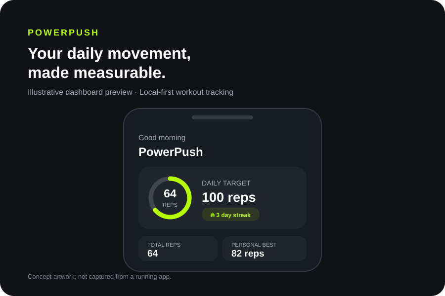

# PowerPush — Flutter push-up tracker

A local-first push-up tracking app starter for iOS and Android, built with Flutter. Track manual reps and sets, review your recent activity, and adjust your daily goal.

> **Status:** Starter project/demo. Rep counting is manual; no camera detection, cloud sync, or background timer is implemented.

## Demo preview



The preview above is an illustrative UI mockup, not a screenshot captured from a running device. See [current app limitations](#current-limitations).

## Features

- Dark Material 3 interface with an electric-lime accent
- Home dashboard with daily target, completion ring, streak, totals, and recent workouts
- Manual workout counter with undo, set logging, timer controls, reset, and session completion
- Local workout history and preferences stored with SharedPreferences
- Last-seven-days progress chart and personal best
- Editable daily target and training level
- Bottom navigation for Home, Workout, Progress, and Profile

## Run the app

Prerequisites: Flutter stable (Dart SDK `>=3.3.0 <4.0.0`) and the iOS or Android toolchain for your target device.

```bash
git clone https://github.com/cyber24shield/powerpush.git
cd powerpush
flutter pub get
flutter test
flutter run
```

To test on a specific connected device, run `flutter devices`, then `flutter run -d <device-id>`.

## Project structure

- `lib/main.dart` — app UI, workout interactions, chart, and local persistence
- `test/widget_test.dart` — basic app-load widget test
- `pubspec.yaml` — Flutter dependencies and app metadata

## Current limitations

- Reps are entered manually; camera-based rep detection is not implemented.
- The workout timer runs only while the app process is active; background timing and notifications are not implemented.
- Data is stored locally. There are no accounts or cloud sync.
- Training plans and reminder scheduling are not implemented.

## Before publishing

Test on supported iOS and Android devices, add branded icons and splash screens, configure application identifiers and signing, review privacy disclosures and store metadata, test accessibility and data deletion, and complete a security and dependency review. This starter is not store-certified.
